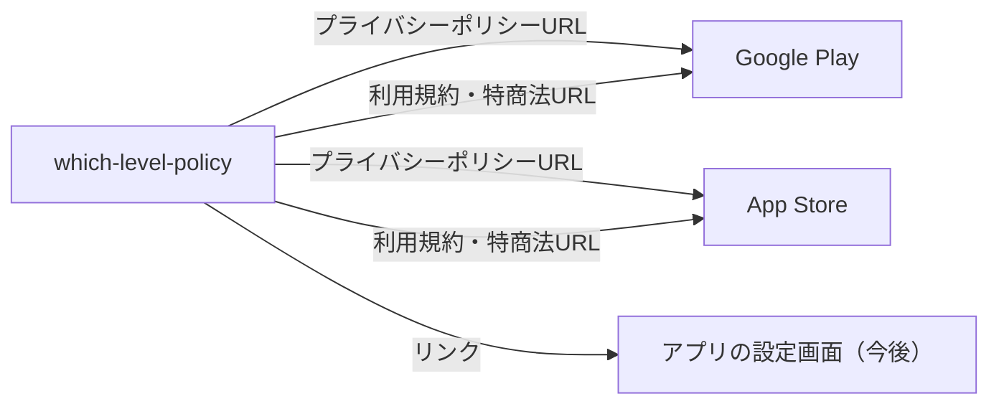
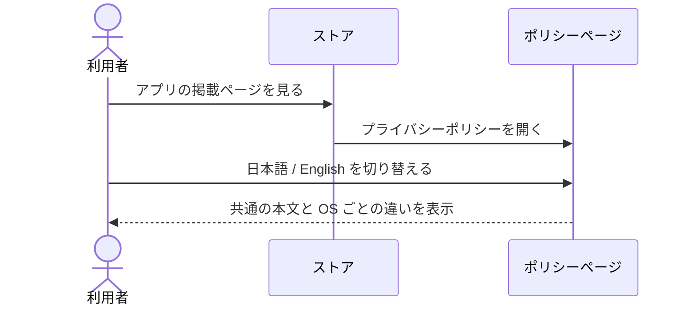
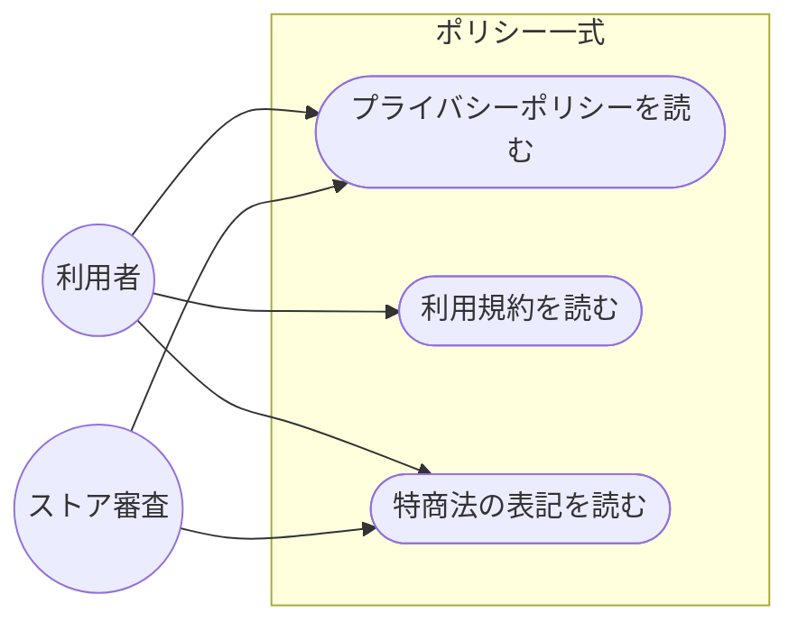
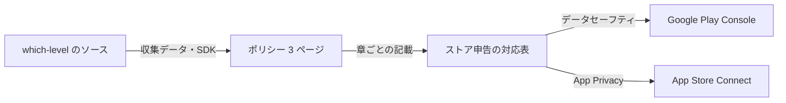
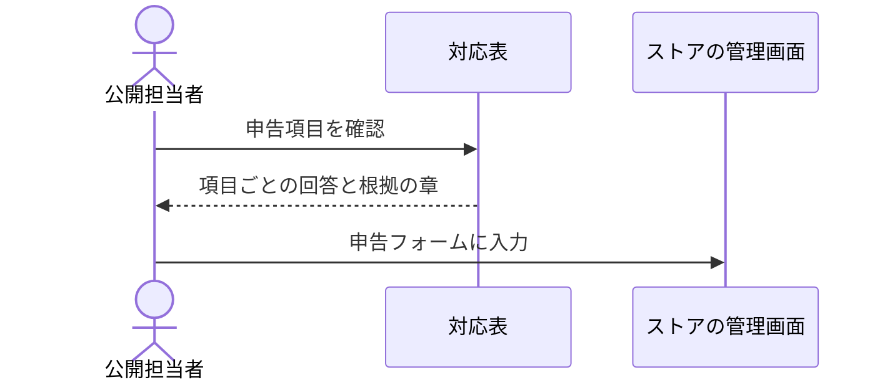
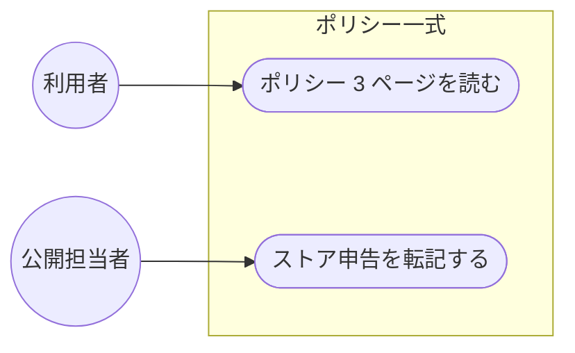
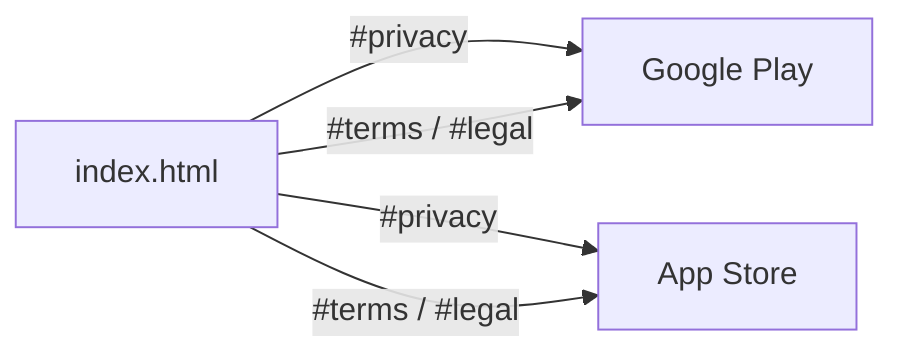
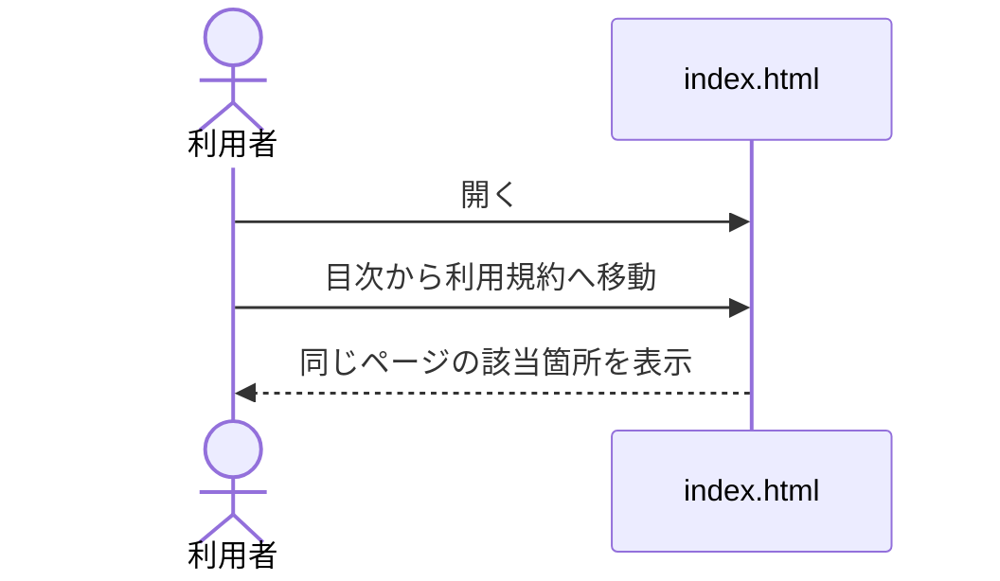
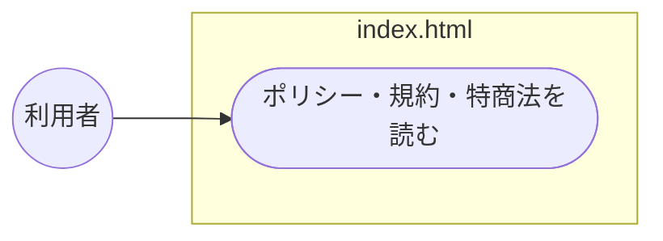

<!-- draft:common:start -->
## 背景
which-level（アプリ名「何階だっけ」/ Which Level?）を Google Play と App Store に公開するため、両ストアの審査に出せるポリシー一式が必要。参考は同じグループの room-check-pdf-policy（プライバシーポリシー・利用規約・特定商取引法に基づく表記の 3 ページ、日英切替）。

## ゴール
Android と iOS で共通に使える 1 本のポリシー一式をこのリポジトリに置き、両ストアに同じ URL を登録できるようにする。

## 要件（ソースで確かめた事実）
- アカウントなし・自社サーバーなし。駐車記録（位置・気圧・階・柱・メモ・写真・OCR文字）は端末内の SQLite と専用フォルダにだけ保存
- 外部へ出るのは: OpenStreetMap 地図タイル / OS の逆ジオコーディング（Android は Google、iOS は Apple）/ Google AdMob・UMP / ストア課金（広告なし版・買い切り）
- 権限: 位置（使用中のみ・正確）、カメラ、モーションセンサー（iOS）、振動、インターネット。写真ライブラリ・マイク・連絡先・バックグラウンド位置は使わない
- 広告: Android は既定（パーソナライズあり）、iOS は非パーソナライズで ATT なし
- 削除: 設定の「すべてのデータを削除」で記録・写真・設定・地図キャッシュを削除（購入状態は残る）。完了記録の写真は既定 90 日で自動削除
- 運営者: 個人開発者 Arrow Code Lab / arrow.code.lab@gmail.com。EEA・英国・スイスでは提供しない
<!-- draft:common:end -->

<!-- draft:A:start -->
## 案A: 参考元と同じ 3 ページ構成（OS の違いは本文の中で書き分け）

#### 確認ページ
- 要約: room-check-pdf-policy と同じ index.html（プライバシーポリシー）・terms.html（利用規約）・legal.html（特定商取引法）の 3 ページを日英切替で作る。Android と iOS で違う所（広告のパーソナライズ、住所変換の提供元、課金ストア、権限名）は同じ章の中で並べて書く
- 得るもの: 参考元と見た目・構成が揃い、両アプリの保守を同じ要領でできる。ストアにはページごとに別 URL を登録できる
- 失うもの: ストアの申告フォーム（データセーフティ / App Privacy）の下書きは含まないので、申告は別に考える必要がある

#### データフロー図
見てほしい点: ポリシーの 3 ページを両ストアとアプリから同じ URL で参照する

#### シーケンス図
見てほしい点: 利用者はストアかアプリからポリシーを開き、日英を切り替えて読む

#### ユースケース図
見てほしい点: 利用者と審査担当の両方が同じページを読む

<!-- draft:A:end -->

<!-- draft:B:start -->
## 案B: 3 ページ ＋ ストア申告の対応表ページ

#### 確認ページ
- 要約: 案Aの 3 ページに加えて、Google Play のデータセーフティと App Store の App Privacy に何を申告するかを、ポリシーの章と突き合わせた対応表のページ（store-declarations.md など）を作る
- 得るもの: ポリシーとストアの申告が食い違う危険が下がり、審査提出時にそのまま転記できる
- 失うもの: 公開しなくてよい内部資料が増え、アプリを変えるたびに直す所が増える。AD_ID 権限の有無など、ビルドしないと確定しない項目が残る

#### データフロー図
見てほしい点: 対応表がポリシーとストアの申告をつなぐ

#### シーケンス図
見てほしい点: 公開担当者が対応表を見ながら申告する

#### ユースケース図
見てほしい点: 公開担当者の作業が 1 つ増える

<!-- draft:B:end -->

<!-- draft:C:start -->
## 案C: 1 ページにまとめる

#### 確認ページ
- 要約: プライバシーポリシー・利用規約・特商法の表記を index.html 1 枚にまとめ、ページ内リンクで移動する
- 得るもの: ファイルが 1 つで済み、直す所が少ない
- 失うもの: 参考元と構成が違ってしまう。ストアに登録する URL がアンカー付きになり、ページも長くなる。特商法の表記を探しにくい

#### データフロー図
見てほしい点: どの URL も 1 枚のページの中を指す

#### シーケンス図
見てほしい点: 利用者は長いページの中を移動する

#### ユースケース図
見てほしい点: 読むページは 1 つだけ

<!-- draft:C:end -->
